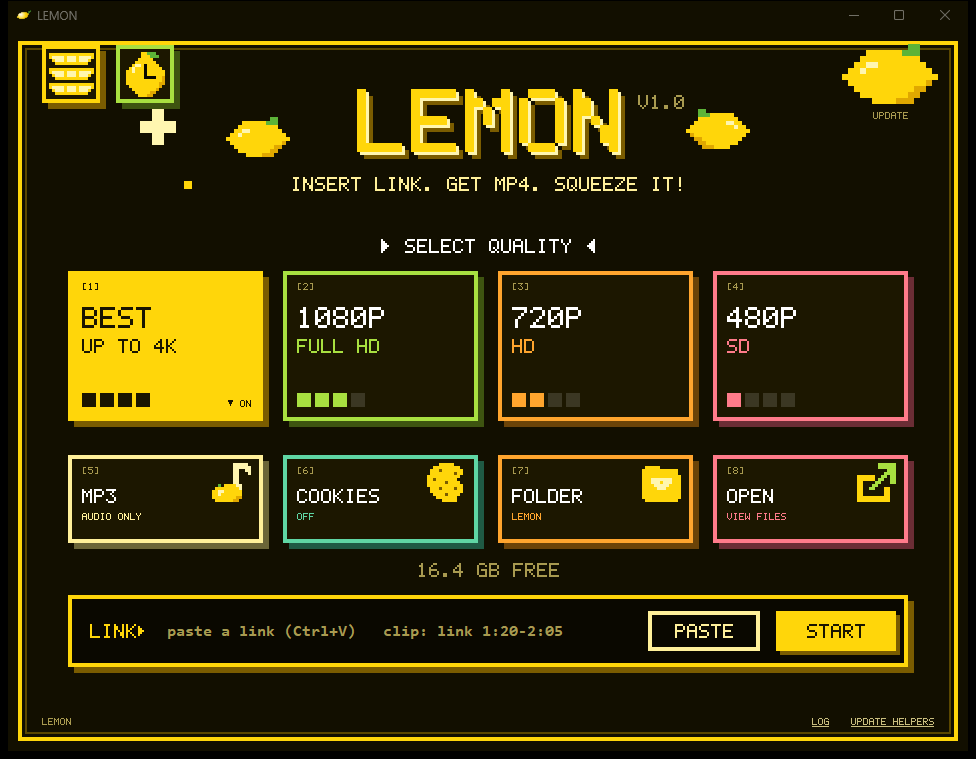
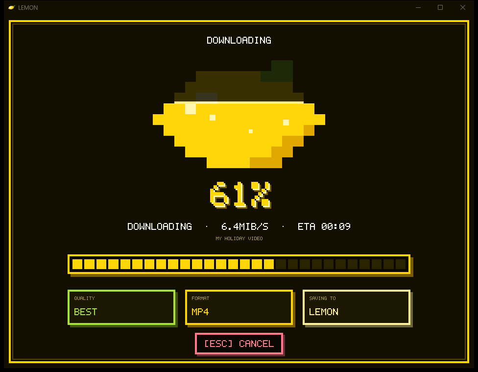

<p align="center">
  
</p>

<h1 align="center">LEMON</h1>

<p align="center">
  <b>🍋 Paste a link. Get an MP4. Squeeze it!</b><br>
  A small, friendly Windows video downloader with a pixel-art lemon that fills up with juice while it works.
</p>

<p align="center">
  <a href="https://github.com/7jzzi/lemon-downloader/releases/latest"></a>
  
  <a href="LICENSE"></a>
  <a href="https://github.com/yt-dlp/yt-dlp"></a>
</p>

<p align="center">
  <a href="https://github.com/7jzzi/lemon-downloader/releases/latest"><b>⬇️ Download the latest version</b></a>
  &nbsp;·&nbsp;
  <a href="#-install">Install</a>
  &nbsp;·&nbsp;
  <a href="#-privacy--safety">Privacy</a>
</p>

<p align="center">
  
  
</p>

---

## ✨ Features

- 🔗 **One-step downloads.** Paste a link and press Start. Get **MP4** (best, 1080p, 720p or 480p) or **audio only** (MP3, M4A or FLAC).
- ✂️ **Clip just a part.** Type `link 1:20-2:05` in the link box to save only that stretch.
- 🎞️ **Extras inside the file.** Optional subtitles (English + Arabic), cover picture, and title / artist / chapter tags.
- 📁 **Sorted for you.** Downloads land in `Youtube`, `Tiktok`, `Instagram`, `Snapchat`, `X` or `Others` inside your save folder.
- ▶️ **Built-in player** with a *Recent* list that remembers where you stopped. (Needs [VLC](https://www.videolan.org/) installed; everything else works without it.)
- 🍪 **Age-restricted or members-only videos?** Optionally let it use your browser's cookies. Off by default.
- 🔔 **Tells you when it's done**, even if you are in another window.
- 🪟 **Runs the way you like.** Start with Windows, keep running in the system tray when you close the window, and only one LEMON at a time.
- 🔄 **Updates itself** from this page's Releases, but only after you say yes and its SHA-256 checks out.
- 🌍 **English and Arabic** interface.
- 🔒 **No account, no ads, no telemetry.**

## 📥 Install

1. Go to the [**Releases**](https://github.com/7jzzi/lemon-downloader/releases/latest) page and download **`LEMON-<version>.zip`** (for example `LEMON-1.0.zip`).
2. Unzip it anywhere you can write to (Documents or Desktop are fine). Keep the `_internal` folder next to `LEMON.exe`.
3. Double-click **`LEMON.exe`**. On first start, choose the folder where videos are saved.

> [!NOTE]
> **Windows may say "Windows protected your PC"** because LEMON is not code-signed. Click *More info* → *Run anyway*. To be sure you have the real file, compare the SHA-256 of the zip with the one shown on the Release page.

| | |
|---|---|
| 💻 **Works on** | Windows (tested on Windows 11) |
| ▶️ **Player** | Optional: install [VLC](https://www.videolan.org/) to watch inside LEMON |
| 🧩 **Nothing else to install** | yt-dlp, ffmpeg and deno are inside the download |

## 🚀 Quick start

1. **Pick a quality** (cards `1`–`4`) or **audio only** (card `5`).
2. **Paste a link** and press **START** (or Enter).
3. Watch the lemon fill up. When it's done the video opens in the built-in player.

| Key | What it does |
|---|---|
| `1` `2` `3` `4` | Best / 1080p / 720p / 480p |
| `5` | Audio only (tap again to cycle MP3 → M4A → FLAC → off) |
| `6` · `7` · `8` | Cookies · Save folder · Open the folder |
| `Ctrl` + `L` | Jump to the link box |
| `Esc` | Cancel a download, close a screen |
| `Space` · `←` `→` · `M` · `F` | In the player: play/pause · jump 10 s · mute · fullscreen |

## 🔒 Privacy & safety

- 🙅 No account, no ads, no telemetry. LEMON never uploads your files or settings.
- 🌐 It only talks to: the site you paste a link from (also when you paste, to read the title and size), `pypi.org` when you press **UPDATE HELPERS**, and `github.com` / `api.github.com` to check for a new version (quietly at start-up, and when you press the lemon at the top right). These requests carry no data about you, but those servers see your IP address like any website does.
- 🔄 LEMON never installs an update without asking. If a newer version exists, pressing the lemon asks Yes/No, then downloads it from this project's GitHub Releases, checks its SHA-256 and swaps it in.
- 🍪 **Cookies** (off by default): the cookies card lets yt-dlp read your logged-in browser cookies. They stay on your PC and are used only for that download.
- 💾 Saved on your PC: settings and the Recent list in `~/.lemon_downloader.json`, and a small log in `%LOCALAPPDATA%\LEMON\lemon.log` (links keep only their video id; cookie and token values are hidden). Video titles and file paths still appear in the log and the Recent list. Delete them any time: clear the Recent list in the app and delete the two files above.
- 🎬 LEMON only opens audio and video files, and only web (`http`/`https`) links.
- 📋 It watches the clipboard for video links while its window is in front, to fill the link box for you. Nothing is stored or sent.

## ⚖️ Use it responsibly

Only download videos you own, that are free to share, or that you otherwise have the right to save, and respect each site's terms of service. LEMON is not affiliated with YouTube or any other site.

## 🙏 Built on

[**yt-dlp**](https://github.com/yt-dlp/yt-dlp) (the download engine), [**ffmpeg**](https://ffmpeg.org/), [**VLC**](https://www.videolan.org/) (the player) and [**deno**](https://deno.com/). Thank you! See [`THIRD_PARTY_NOTICES.md`](THIRD_PARTY_NOTICES.md) for their licenses.

## 🛠️ Build it yourself

Needs Python 3.12+ with `yt-dlp[default] imageio-ffmpeg deno python-vlc pyinstaller`.

```
python exe_build\build_exe.py --out build
python -m unittest discover -s tests
```

## 📄 License

LEMON is free software under the [GNU General Public License v3.0](LICENSE): you may use, change and share it, as long as shared copies stay under the same license and come with their source code.

<p align="center"><sub>Made with 🍋 and a lot of juice.</sub></p>
